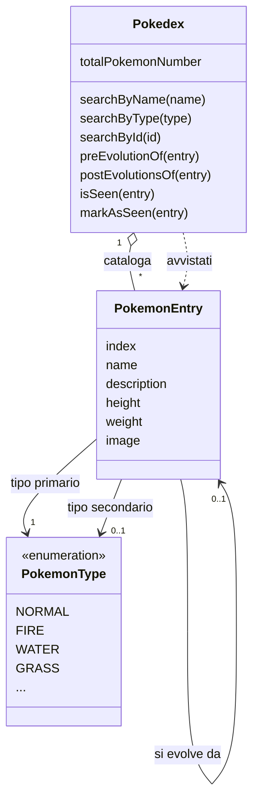

# Analisi

Questo documento descrive **cosa** il sistema deve fare, non **come** lo fa.
Le scelte di progettazione (interfacce, classi, pattern) vengono dopo e devono poter essere giustificate a partire da qui.

## 1. Requisiti

### 1.1 Requisiti funzionali

| ID  | Requisito |
|-----|-----------|
| RF1 | Il sistema mostra l'elenco di **tutti** i Pokémon del Pokédex, ordinati per numero. |
| RF2 | Nell'elenco, di ogni Pokémon avvistato si vedono numero e nome; di uno non avvistato solo il numero (il nome è `???`). |
| RF3 | Selezionando un Pokémon dall'elenco, il sistema ne mostra la **scheda di dettaglio**: numero, nome, tipi, altezza, peso, descrizione e immagine. |
| RF4 | Se il Pokémon selezionato non è stato avvistato, la scheda mostra solo il numero; tutte le altre informazioni sono nascoste (`???`) e l'immagine non è visibile. |
| RF5 | L'utente può **registrare l'avvistamento** del Pokémon selezionato; da quel momento le sue informazioni sono visibili sia nella scheda sia nell'elenco. |
| RF6 | L'utente può **cercare** un Pokémon per nome; se esiste, viene selezionato e ne viene mostrata la scheda, altrimenti il sistema segnala che non è stato trovato. |
| RF7 | Svuotando la ricerca, il sistema torna a mostrare l'elenco completo. |
| RF8 | All'avvio, il sistema carica il catalogo delle specie e lo stato degli avvistamenti da un file JSON e mostra la scheda del primo Pokémon. |

#### Requisiti opzionali

| ID   | Requisito |
|------|-----------|
| RFO1 | L'utente può **filtrare** l'elenco per tipo (es. tutti i Pokémon di tipo *Fuoco*, anche se è il loro tipo secondario). |
| RFO2 | La scheda di dettaglio mostra la **catena evolutiva** del Pokémon (da chi si evolve, in chi si evolve) e permette di navigarla. |

### 1.2 Requisiti non funzionali

| ID   | Requisito |
|------|-----------|
| RNF1 | L'interfaccia è un'applicazione desktop realizzata con JavaFX. |
| RNF2 | Il modello del dominio deve essere **indipendente** dall'interfaccia grafica e dal formato di memorizzazione: deve poter essere testato senza avviare JavaFX e senza leggere file. |
| RNF3 | Aggiungere una nuova specie deve richiedere solo di modificare il file dei dati (e aggiungere l'immagine), non il codice. |
| RNF4 | La logica del dominio è coperta da test automatici (JUnit). |

## 2. Analisi e modello del dominio

### 2.1 Glossario

| Termine | Significato |
|---------|-------------|
| **Pokédex** | Il catalogo di tutte le specie conosciute, insieme agli avvistamenti dell'utente. |
| **Specie / Voce** (*Pokemon entry*) | La descrizione di un tipo di Pokémon: numero, nome, descrizione, tipi, misure, immagine. È un'informazione **fissa**: non cambia durante l'uso dell'applicazione. |
| **Numero** (*index*) | Identifica univocamente una specie nel Pokédex. |
| **Tipo** | Categoria elementale (Fuoco, Acqua, Erba, …). L'insieme dei tipi è fissato. Ogni specie ha un tipo primario e, opzionalmente, un tipo secondario **diverso** dal primario. |
| **Evoluzione** | Relazione tra due specie: *B si evolve da A*. Una specie ha **al più una** pre-evoluzione e **zero o più** post-evoluzioni (es. Eevee). |
| **Avvistamento** | Il fatto che l'utente abbia già incontrato una specie. È uno stato **dell'utente**, non della specie, e cambia nel tempo. |

### 2.2 Modello del dominio

Il **Pokédex** è l'entità centrale. Contiene le specie e sa quali l'utente ha avvistato.
Ogni **voce** descrive una specie, ha uno o due **tipi** e può evolversi da un'altra voce.

**Vincoli del dominio** (invarianti da garantire in progettazione e da verificare con i test):

- il numero di una specie è unico nel Pokédex, e lo stesso vale per il nome;
- il tipo secondario, se presente, è diverso dal primario;
- una specie non può evolversi da sé stessa;
- si può chiedere se una specie è stata avvistata, o registrarne l'avvistamento, solo se la specie appartiene al Pokédex.

### 2.3 Elementi critici

Alcuni aspetti del dominio sembrano banali ma influenzano molto la progettazione.

**Dove vive lo stato "avvistato"?**
Mettere un flag `seen` nella voce sembra naturale, ma rende mutabile un'informazione che per il resto è fissa.
Mescola inoltre due concetti diversi: *com'è fatto Bulbasaur* (uguale per tutti) e *se io ho visto Bulbasaur*
(dipende dall'utente). L'avvistamento è quindi responsabilità del Pokédex, e le voci rimangono immutabili.

**Come rappresentare le evoluzioni?**
La relazione evolutiva forma un grafo con riferimenti nei due versi (pre ↔ post).
Un grafo con cicli non si costruisce con oggetti immutabili che si referenziano direttamente: uno dei due deve
esistere prima dell'altro.
Memorizzare *entrambi* i versi crea inoltre due fonti della stessa informazione, che possono divergere
(A dice "evolvo in B", B dice "evolvo da C").
La relazione va quindi memorizzata **una sola volta**: ogni voce conosce solo il *numero* della sua pre-evoluzione,
e il Pokédex ricava l'altro verso.

**Separare il dominio dalla presentazione.**
L'immagine o il testo `???` riguardano il *modo di mostrare* un Pokémon, non il Pokémon.
Il dominio espone i dati e lo stato di avvistamento; decidere cosa nascondere e come è compito della presentazione
(RNF2).
