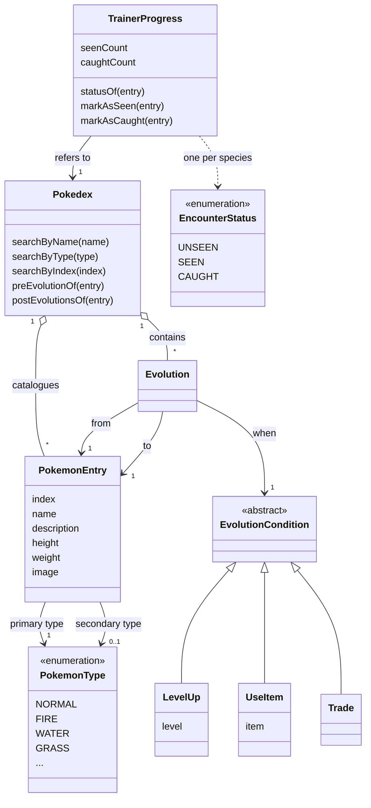

# Analisi

Ricordatevi: questo parte del progetto si deve focalizzare su **cosa** il sistema **deve** fare,
non sul **come** lo farà.
NON devono emergere scelta architetturali (es. MVC), di implementazione (es. view in JavaFX). 
Dove ragionare al livello del Dominio
Le scelte di architettura e di design vengono dopo e devono poter essere giustificate a partire da qui.

## 1. Requisiti

### 1.1 Requisiti funzionali

| ID  | Requisito |
|-----|-----------|
| RF1 | Il sistema mostra l'elenco di **tutti** i Pokémon del Pokédex, ordinati per numero. |
| RF2 | Nell'elenco, di un Pokémon avvistato si vedono numero e nome; di uno non avvistato solo il numero (il nome è `???`). I Pokémon catturati sono contrassegnati. |
| RF3 | Selezionando un Pokémon dall'elenco, il sistema ne mostra la **scheda di dettaglio**: numero, nome, tipi, altezza, peso, descrizione, immagine e stato (avvistato o catturato). |
| RF4 | Se il Pokémon selezionato non è stato avvistato, la scheda mostra solo il numero; tutte le altre informazioni sono nascoste (`???`) e l'immagine non è visibile. |
| RF5 | L'utente può **registrare l'avvistamento** del Pokémon selezionato; da quel momento le sue informazioni sono visibili sia nella scheda sia nell'elenco. |
| RF6 | L'utente può **registrare la cattura** del Pokémon selezionato; un Pokémon catturato risulta anche avvistato. |
| RF7 | L'utente può **cercare** un Pokémon per nome; se esiste, viene selezionato e ne viene mostrata la scheda, altrimenti il sistema segnala che non è stato trovato. |
| RF8 | Svuotando la ricerca, il sistema torna a mostrare l'elenco completo. |
| RF9 | All'avvio, il sistema carica da un file il catalogo delle specie e delle loro evoluzioni, parte con i progressi vuoti e mostra la scheda del primo Pokémon. |

#### Requisiti opzionali

| ID   | Requisito |
|------|-----------|
| RFO1 | L'utente può **filtrare** l'elenco per tipo (es. tutti i Pokémon di tipo *Fuoco*, anche se è il loro tipo secondario). |
| RFO2 | La scheda di dettaglio mostra la **catena evolutiva** del Pokémon, con le condizioni di ogni evoluzione (es. "Lv. 16", "Pietratuono", "Scambio"), e permette di navigarla. |
| RFO3 | Il sistema mostra quanti Pokémon sono stati avvistati e quanti catturati, rispetto al totale. |
| RFO4 | I progressi dell'allenatore vengono salvati e ricaricati tra un avvio e l'altro. |

### 1.2 Requisiti non funzionali

| ID   | Requisito |
|------|-----------|
| RNF1 | **Portabilità**: il sistema è un'applicazione desktop che funziona su Windows, macOS e Linux, e non richiede una connessione di rete. |
| RNF2 | **Estendibilità dei dati**: aggiungere una specie o un'evoluzione richiede solo di modificare i dati (e aggiungere l'immagine), non il programma. |
| RNF3 | **Robustezza**: dati che violano i vincoli del dominio vengono rifiutati all'avvio, con un messaggio che indica la voce e il vincolo violato. Il sistema non mostra mai dati incoerenti. |
| RNF4 | **Prestazioni**: anche con un catalogo grande quanto il Pokédex completo (circa 1000 specie), l'avvio richiede pochi secondi, e la selezione e la ricerca rispondono in modo percepito come immediato (meno di 0,1 secondi). |
| RNF6 | **Usabilità**: tutte le funzioni sono disponibili da un'unica finestra, senza menu annidati, e ogni azione ha un riscontro immediato: la scheda si aggiorna, oppure compare un messaggio che spiega cosa non è andato. |

## 2. Analisi e modello del dominio

### 2.1 Glossario

| Termine | Significato |
|---------|-------------|
| **Pokédex** (catalogo) — *Pokedex* | L'insieme di tutte le specie conosciute e delle evoluzioni tra di esse. È **fisso**: non cambia durante l'uso. |
| **Specie / Voce** — *PokemonEntry* | La descrizione di un tipo di Pokémon: numero, nome, descrizione, tipi, misure, immagine. |
| **Numero** — *index* | Identifica univocamente una specie nel Pokédex. |
| **Tipo** — *PokemonType* | Categoria elementale (Fuoco, Acqua, Erba, …). L'insieme dei tipi è fissato. Ogni specie ha un tipo primario e, opzionalmente, un tipo secondario. |
| **Evoluzione** — *Evolution* | Relazione tra due specie, *A si evolve in B*, che avviene a una certa condizione. |
| **Condizione di evoluzione** — *EvolutionCondition* | Cosa fa evolvere un Pokémon: raggiungere un **livello** (*LevelUp*, da 1 a 100), usare uno **strumento** (*UseItem*), oppure uno **scambio** (*Trade*). Le condizioni possibili sono solo queste. |
| **Catena evolutiva** — *evolution chain* | Sequenza di evoluzioni consecutive (Charmander → Charmeleon → Charizard). |
| **Progressi dell'allenatore** — *TrainerProgress* | Per ogni specie del Pokédex, lo stato raggiunto dall'allenatore. Cambiano nel tempo e sono diversi per ogni allenatore. |
| **Stato di incontro** — *EncounterStatus* | *Non avvistato* (UNSEEN), *avvistato* (SEEN) o *catturato* (CAUGHT). |

### 2.2 Modello del dominio

Il **Pokédex** (*Pokedex*) è il catalogo di tutte le specie conosciute e delle evoluzioni tra di esse. Permette di
cercare una specie per nome, per tipo o per numero, e di sapere da quale specie si evolve una specie e in quali si
evolve.

Ogni **specie** (*PokemonEntry*) è identificata dal suo **numero** (*index*): nel Pokédex non ci sono due specie con lo
stesso numero, né con lo stesso nome (V1). Una specie ha un tipo primario e, opzionalmente, un tipo secondario, che è
sempre diverso dal primario (V2).

Un'**evoluzione** (*Evolution*) collega una specie di partenza a una specie di arrivo, che sono diverse (V3) e
appartengono entrambe al Pokédex (V4). L'evoluzione avviene a una **condizione** (*EvolutionCondition*), di uno fra
tre tipi: il raggiungimento di un livello, compreso tra 1 e 100 (*LevelUp*); l'uso di uno strumento, che ha sempre un
nome (*UseItem*) (V7); oppure uno scambio (*Trade*).
Considerate nel loro insieme, le evoluzioni rispettano tre regole:

- una specie si evolve da **al più una** specie, ma può evolversi in più specie (V5);
- seguendo una catena non si torna mai a una specie già incontrata: le evoluzioni non formano **cicli** (V6);
- lungo una catena, se due evoluzioni consecutive avvengono per livello, la seconda richiede un livello **maggiore**
  della prima, come in Charmander → Charmeleon al 16 e Charmeleon → Charizard al 36 (V8).

I **progressi dell'allenatore** (*TrainerProgress*) sono un'entità separata dal catalogo e si riferiscono a un
Pokédex: registrano lo **stato di incontro** (*EncounterStatus*) di ciascuna delle sue specie, e solo di quelle (V9).
Ogni allenatore ha i propri progressi, indipendenti da quelli degli altri (V11).
Lo stato di incontro **avanza soltanto**, da *non avvistato* ad *avvistato* a *catturato*: catturare un Pokémon
implica averlo avvistato, e registrare l'avvistamento di un Pokémon già catturato non cambia nulla (V10).