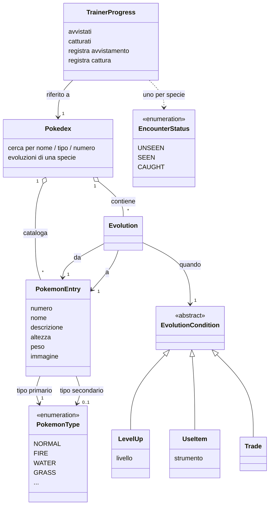

# Analisi

Questo documento descrive **cosa** il sistema deve fare, non **come** lo fa.
Le scelte di architettura e di design vengono dopo e devono poter essere giustificate a partire da qui.

## 1. Requisiti

### 1.1 Requisiti funzionali

| ID  | Requisito |
|-----|-----------|
| RF1 | Il sistema mostra l'elenco di **tutti** i Pokémon del Pokédex, ordinati per numero. |
| RF2 | Nell'elenco, di un Pokémon avvistato si vedono numero e nome; di uno non avvistato solo il numero (il nome è `???`). I Pokémon catturati sono contrassegnati. |
| RF3 | Selezionando un Pokémon dall'elenco, il sistema ne mostra la **scheda di dettaglio**: numero, nome, tipi, altezza, peso, descrizione, immagine e stato (avvistato o catturato). |
| RF4 | Se il Pokémon selezionato non è stato avvistato, la scheda mostra solo il numero; tutte le altre informazioni sono nascoste (`???`) e l'immagine non è visibile. |
| RF5 | L'utente può **registrare l'avvistamento** del Pokémon selezionato; da quel momento le sue informazioni sono visibili sia nella scheda sia nell'elenco. |
| RF6 | L'utente può **registrare la cattura** del Pokémon selezionato; un Pokémon catturato risulta anche avvistato. |
| RF7 | L'utente può **cercare** un Pokémon per nome; se esiste, viene selezionato e ne viene mostrata la scheda, altrimenti il sistema segnala che non è stato trovato. |
| RF8 | Svuotando la ricerca, il sistema torna a mostrare l'elenco completo. |
| RF9 | All'avvio, il sistema carica da un file JSON il catalogo delle specie e delle loro evoluzioni, parte con i progressi vuoti e mostra la scheda del primo Pokémon. |

#### Requisiti opzionali

| ID   | Requisito |
|------|-----------|
| RFO1 | L'utente può **filtrare** l'elenco per tipo (es. tutti i Pokémon di tipo *Fuoco*, anche se è il loro tipo secondario). |
| RFO2 | La scheda di dettaglio mostra la **catena evolutiva** del Pokémon, con le condizioni di ogni evoluzione (es. "Lv. 16", "Pietratuono", "Scambio"), e permette di navigarla. |
| RFO3 | Il sistema mostra quanti Pokémon sono stati avvistati e quanti catturati, rispetto al totale. |
| RFO4 | I progressi dell'allenatore vengono salvati e ricaricati tra un avvio e l'altro. |

### 1.2 Requisiti non funzionali

| ID   | Requisito |
|------|-----------|
| RNF1 | L'interfaccia è un'applicazione desktop realizzata con JavaFX. |
| RNF2 | Il modello del dominio deve essere **indipendente** dall'interfaccia grafica e dal formato di memorizzazione: deve poter essere testato senza avviare JavaFX e senza leggere file. |
| RNF3 | Aggiungere una nuova specie, o una nuova evoluzione, deve richiedere solo di modificare il file dei dati (e aggiungere l'immagine), non il codice. |
| RNF4 | Un file dei dati che viola i vincoli del dominio viene rifiutato all'avvio, con un messaggio che indica il problema. |
| RNF5 | La logica del dominio è coperta da test automatici (JUnit). |

## 2. Analisi e modello del dominio

### 2.1 Glossario

| Termine | Significato |
|---------|-------------|
| **Pokédex** (catalogo) | L'insieme di tutte le specie conosciute e delle evoluzioni tra di esse. È **fisso**: non cambia durante l'uso. |
| **Specie / Voce** (*Pokemon entry*) | La descrizione di un tipo di Pokémon: numero, nome, descrizione, tipi, misure, immagine. |
| **Numero** (*index*) | Identifica univocamente una specie nel Pokédex. |
| **Tipo** | Categoria elementale (Fuoco, Acqua, Erba, …). L'insieme dei tipi è fissato. Ogni specie ha un tipo primario e, opzionalmente, un tipo secondario. |
| **Evoluzione** | Relazione tra due specie, *A si evolve in B*, che avviene a una certa condizione. |
| **Condizione di evoluzione** | Cosa fa evolvere un Pokémon: raggiungere un **livello** (da 1 a 100), usare uno **strumento**, oppure uno **scambio**. Le condizioni possibili sono solo queste. |
| **Catena evolutiva** | Sequenza di evoluzioni consecutive (Charmander → Charmeleon → Charizard). |
| **Progressi dell'allenatore** | Per ogni specie del Pokédex, lo stato raggiunto dall'allenatore. Cambiano nel tempo e sono diversi per ogni allenatore. |
| **Stato di incontro** | *Non avvistato*, *avvistato* o *catturato*. |

### 2.2 Modello del dominio

Il **Pokédex** è il catalogo: contiene le specie e le evoluzioni tra di esse.
Ogni **specie** ha uno o due **tipi**.
Un'**evoluzione** collega due specie e ha una **condizione**, che può essere di tre tipi diversi.
I **progressi dell'allenatore** sono un'entità separata, riferita a un Pokédex: per ogni specie registrano lo
**stato di incontro**.

### 2.3 Vincoli del dominio

Sono le regole che devono valere sempre; in progettazione andrà deciso chi le garantisce, e ciascuna avrà un test.

**Specie**

- V1. Il numero di una specie è unico nel Pokédex, e lo stesso vale per il nome.
- V2. Il tipo secondario, se presente, è diverso dal primario.

**Evoluzioni**

- V3. Una specie non può evolversi in sé stessa.
- V4. Entrambe le specie di un'evoluzione appartengono al Pokédex.
- V5. Una specie si evolve da **al più una** specie (ma può evolversi in più specie).
- V6. Le evoluzioni non formano **cicli**: seguendo una catena non si torna mai a una specie già incontrata.
- V7. Il livello di un'evoluzione è compreso tra 1 e 100; uno strumento ha sempre un nome.
- V8. Lungo una catena, se due evoluzioni consecutive avvengono per livello, la seconda richiede un livello
  **maggiore** della prima (Charmander → Charmeleon al 16, Charmeleon → Charizard al 36).

**Progressi**

- V9. Si possono registrare progressi solo per specie del Pokédex a cui i progressi si riferiscono.
- V10. Lo stato di incontro **avanza soltanto**: non avvistato → avvistato → catturato. Catturare un Pokémon implica
  averlo avvistato; registrare l'avvistamento di un Pokémon già catturato non cambia nulla.
- V11. I progressi di allenatori diversi sono indipendenti.

### 2.4 Elementi critici

Alcuni aspetti del dominio sembrano banali ma influenzano molto la progettazione.

**Catalogo e progressi sono due cose diverse.**
Mettere un flag "avvistato" nella specie, o nel Pokédex, sembra naturale, ma mescola due concetti:
*com'è fatto Bulbasaur* (uguale per tutti, fisso) e *a che punto è un allenatore con Bulbasaur* (dipende
dall'allenatore e cambia nel tempo).
Separarli lascia il catalogo immutabile, permette più allenatori sullo stesso catalogo (V11) e isola in un solo posto
le regole sullo stato di incontro (V10).

**L'evoluzione è un'entità, non un attributo.**
Un'evoluzione ha dati propri (la condizione), quindi non può essere un semplice riferimento "evolve in" dentro la specie.
Le evoluzioni formano un grafo in cui le specie sono i nodi e le evoluzioni gli archi.
Se fossero le specie a conoscere le proprie evoluzioni, in entrambi i versi, si avrebbero riferimenti circolari tra
oggetti, e due fonti della stessa informazione che possono divergere.
Se invece le specie non sanno nulla delle evoluzioni, il grafo si costruisce in modo semplice: prima i nodi, poi gli
archi.

**Alcuni vincoli riguardano un solo oggetto, altri l'insieme.**
V2, V3 e V7 si verificano guardando una sola specie o una sola evoluzione.
V1, V4, V5, V6 e V8, invece, si possono verificare solo conoscendo **tutte** le specie e **tutte** le evoluzioni:
la responsabilità spetta a chi ha questa visione d'insieme, cioè al Pokédex.

**Le condizioni di evoluzione sono un insieme chiuso.**
Livello, strumento e scambio: le varianti sono note a priori e ognuna ha dati diversi (un numero, un nome, nulla).
Chi mostra o elabora una condizione deve gestirle tutte, e conviene che sia il compilatore ad accorgersi se ne manca una.

**Separare il dominio dalla presentazione.**
Il testo `???` o un'immagine nascosta riguardano il *modo di mostrare* un Pokémon, non il Pokémon.
Il dominio espone i dati e lo stato di incontro; decidere cosa nascondere e come è compito della presentazione
(RNF2).
