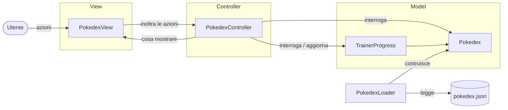
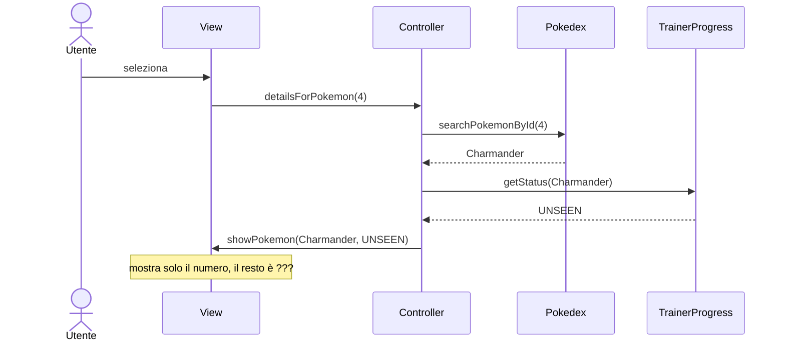
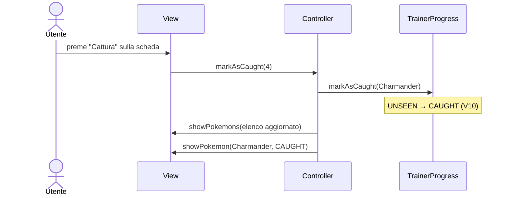

# Architettura

L'architettura stabilisce **in quali parti** si divide il sistema, **di cosa è responsabile** ciascuna parte e **come
comunicano**. Non entra nel dettaglio delle classi: quello è compito del [design](design.md).

## 1. Stile architetturale: MVC

Il sistema segue il pattern **Model-View-Controller**.
Il motivo principale è RNF2: il dominio deve essere testabile senza interfaccia grafica, quindi non deve dipendere da
essa. Il secondo è che la stessa logica (cosa succede quando l'utente cerca, seleziona o registra una cattura) deve
poter essere verificata senza cliccare: serve una parte che la contenga e che non dipenda da JavaFX.

| Parte | Responsabilità | Non deve |
|-------|----------------|----------|
| **Model** (`Pokedex`, `TrainerProgress`) | Rappresentare il dominio e garantirne i vincoli (V1–V11 dell'analisi). | Conoscere view, controller, JavaFX o il formato JSON. |
| **Caricamento** (`PokedexLoader`) | Costruire il Pokédex a partire dal file dei dati, rifiutando dati non validi (RNF4). | Contenere regole del dominio: i vincoli li verifica il model. |
| **View** (`PokedexView`) | Mostrare ciò che le viene chiesto (elenco, scheda, errori) e inoltrare al controller le azioni dell'utente. Decide *come* nascondere un Pokémon non avvistato. | Interrogare o modificare il model; decidere *cosa* mostrare. |
| **Controller** (`PokedexController`) | Reagire alle azioni dell'utente: interrogare o aggiornare il model e dire alla view cosa mostrare. | Conoscere JavaFX. |

## 2. Dipendenze

Le dipendenze vanno in un solo verso: **view → controller → model**.
Il controller conosce la view solo tramite la sua interfaccia, e il model non conosce nessuno dei due.

- Il **model** non dipende da nulla: si può compilare e testare da solo (RNF2, RNF5).
- Il **controller** dipende dal model e dall'*interfaccia* della view. Nei test, la view può essere sostituita da una
  view finta che registra cosa le viene chiesto di mostrare.
- La **view** dipende dall'*interfaccia* del controller. Riceve i dati da mostrare già pronti: le specie (immutabili) e
  il loro stato di incontro.

### Composition root

C'è un solo punto del programma che conosce le classi concrete di tutte le parti: la **composition root**
(`PokedexApp`). All'avvio:

1. carica il Pokédex con il `PokedexLoader`;
2. crea i progressi dell'allenatore, vuoti (RF9);
3. crea la view e il controller e li collega;
4. avvia il controller, che mostra l'elenco e il primo Pokémon;
5. rende visibile la finestra.

Nessuna parte crea da sé i propri collaboratori: la view non crea il controller e il controller non carica il Pokédex.

## 3. Interazioni

Ogni requisito funzionale si traduce in un'interazione tra le parti. Le principali:

### Selezione di un Pokémon (RF3, RF4)

### Registrazione di una cattura (RF6)

### Ricerca per nome (RF7, RF8)

La view inoltra il testo cercato al controller. Se il testo è vuoto, il controller mostra l'elenco completo.
Altrimenti cerca nel Pokédex: se trova il Pokémon lo seleziona come nella selezione, altrimenti chiede alla view di
mostrare un errore.

## 4. Regole

1. **Il model non dipende da nulla.** Niente JavaFX, niente JSON, niente controller.
2. **La view è passiva.** Non interroga il model: riceve tutto ciò che deve mostrare.
3. **Il controller non conosce JavaFX.** Si testa con una view finta.
4. **I costruttori non hanno effetti collaterali.** Costruire il controller non aggiorna la view: l'interazione
   comincia con un avvio esplicito.
5. **Un solo punto crea e collega le parti**: la composition root.
6. **Le parti comunicano tramite interfacce**, mai tramite le classi concrete.

## 5. Organizzazione in package

| Package | Contenuto |
|---------|-----------|
| `it.unibo.pokemon` | `Launcher` e composition root (`PokedexApp`) |
| `it.unibo.pokemon.core` | interfacce e tipi del dominio, `PokedexLoader` |
| `it.unibo.pokemon.core.impl` | implementazioni del dominio |
| `it.unibo.pokemon.controller` (`.impl`) | interfaccia del controller e sua implementazione |
| `it.unibo.pokemon.view` (`.impl`, `.panel`) | interfaccia della view, implementazione JavaFX e suoi pannelli |
