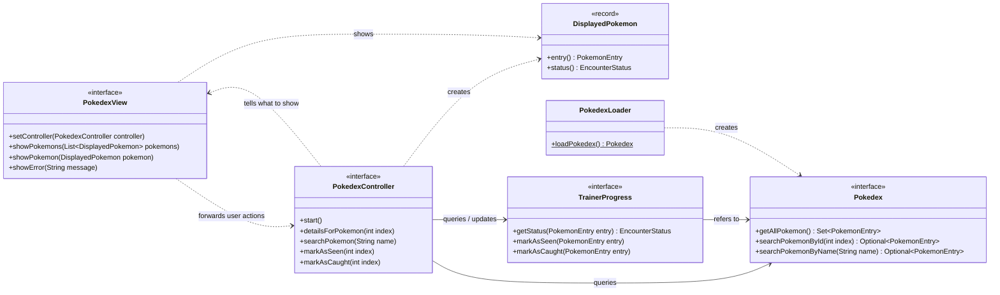
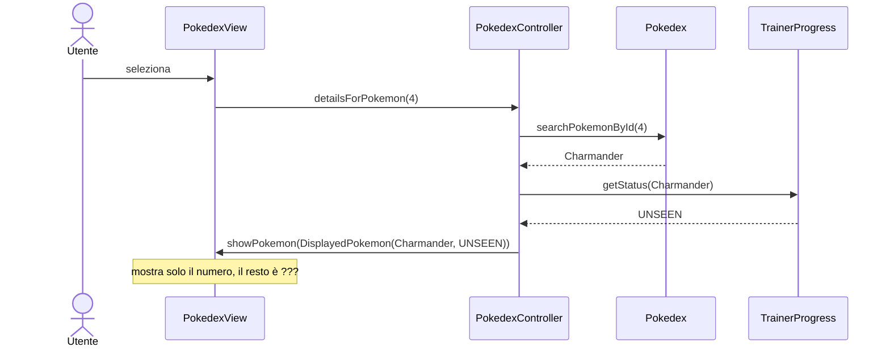
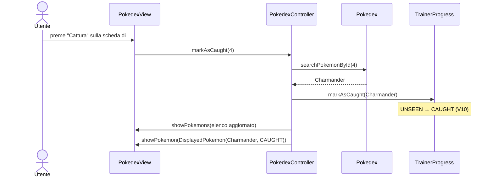

# Architettura

L'architettura stabilisce **in quali parti** si divide il sistema, **di cosa è responsabile** ciascuna parte e **come
comunicano**. Non entra nel dettaglio delle classi: quello è compito del [design](design.md).

## 1. Stile architetturale: MVC

Il sistema segue il pattern **Model-View-Controller**.
Il motivo principale è tenere le regole del dominio **indipendenti dall'interfaccia**. L'interfaccia è la parte che
cambia più spesso, e deve poter essere sostituita (per esempio con una testuale) senza toccare il dominio.
Il dominio, inoltre, deve poter essere verificato con test automatici senza avviare l'interfaccia.
Lo stesso vale per la reazione alle azioni dell'utente (cosa succede quando cerca, seleziona o registra una cattura):
deve poter essere verificata senza cliccare, quindi serve una parte che la contenga e che non dipenda dalla tecnologia
dell'interfaccia.

## 2. Componenti

Lo schema mostra solo i metodi con cui le parti comunicano. Le altre operazioni (per esempio le evoluzioni nel
`Pokedex`) sono descritte nel [design](design.md).

Il **model** è formato da due entità. `Pokedex` è il catalogo delle specie e delle evoluzioni, mentre
`TrainerProgress` registra i progressi dell'allenatore. Insieme garantiscono i vincoli del dominio (V1–V11
dell'analisi). Il model non conosce né la view né il controller: sono gli altri a usarlo.

Il `Pokedex` viene costruito dal `PokedexLoader` a partire dal file dei dati. Il loader si limita a tradurre i dati
nelle entità del dominio; se i dati violano un vincolo, è il `Pokedex` stesso ad accorgersene, e il loader rifiuta il
file (RNF3).

La **view**, `PokedexView`, ha due ruoli: mostrare ciò che le viene chiesto (l'elenco, la scheda di un Pokémon, un
errore) e inoltrare al controller le azioni dell'utente. Ogni volta che l'utente seleziona, cerca o registra qualcosa,
la view chiama il metodo corrispondente del `PokedexController`. Decide *come* nascondere un Pokémon non avvistato, ma
non *se* nasconderlo: questa informazione le arriva dal controller.

Il **controller**, `PokedexController`, reagisce alle azioni dell'utente. Interroga il `Pokedex`, interroga o aggiorna
il `TrainerProgress`, e infine decide cosa mostrare e lo comunica alla `PokedexView`.

Ciò che il controller passa alla view è un `DisplayedPokemon`: una specie (`PokemonEntry`, immutabile) insieme al suo
stato di incontro (`EncounterStatus`). Così la view ha tutto ciò che le serve, senza bisogno di interrogare il model.

## 3. Dipendenze

Le dipendenze vanno in un solo verso: **view → controller → model**.
Il controller conosce la view solo tramite l'interfaccia `PokedexView`, e il model non conosce nessuno dei due.

- Il **model** non dipende da nulla: si può compilare e testare da solo.
- Il **controller** dipende dal model e dall'interfaccia `PokedexView`. Nei test, la view può essere sostituita da una
  view finta che registra cosa le viene chiesto di mostrare.
- La **view** dipende dall'interfaccia `PokedexController`, e riceve i dati da mostrare già pronti.

## 4. Interazioni

Ogni requisito funzionale si traduce in un'interazione tra le parti. Le principali:

### Selezione di un Pokémon (RF3, RF4)

### Registrazione di una cattura (RF6)

### Ricerca per nome (RF7, RF8)

La `PokedexView` inoltra il testo cercato con `searchPokemon(name)`. Se il testo è vuoto, il controller mostra
l'elenco completo con `showPokemons`. Altrimenti lo cerca con `searchPokemonByName`: se trova il Pokémon lo mostra
come nella selezione, altrimenti chiama `showError`.

## 5. Sostituire la view, aggiungere funzionalità

**Sostituire la view.** Per passare da un'interfaccia grafica a una testuale, o a un'altra libreria grafica, basta
una nuova implementazione di `PokedexView` e una riga in `PokedexApp`, dove le parti vengono create. `PokedexController` e il model non
cambiano: il controller conosce solo l'interfaccia, e il model non conosce nessuno dei due.

**Aggiungere una funzionalità.** Un requisito opzionale come il filtro per tipo (RFO1) richiede un'operazione del
`PokedexController` (`searchPokemonByType`, già presente), che usa una ricerca già offerta dal `Pokedex`, e un nuovo
controllo nella view, che la chiama.
La view continua a mostrare un elenco di `DisplayedPokemon`, e il model non cambia.
Una funzionalità che riguarda il dominio, come la catena evolutiva (RFO2), richiede invece di estendere anche ciò che
il controller passa alla view.

## 6. Regole

1. **Il model non dipende da nulla.** Niente interfaccia grafica, niente formato dei dati, niente controller.
2. **La view è passiva.** Non interroga il model: riceve tutto ciò che deve mostrare.
3. **Il controller non dipende dalla tecnologia dell'interfaccia.** Si testa con una view finta.
4. **I costruttori non hanno effetti collaterali.** Costruire il controller non aggiorna la view: l'interazione
   comincia con `start()`.
5. **Un solo punto crea e collega le parti**: `PokedexApp`.
6. **Le parti comunicano tramite interfacce**, mai tramite le classi concrete.
