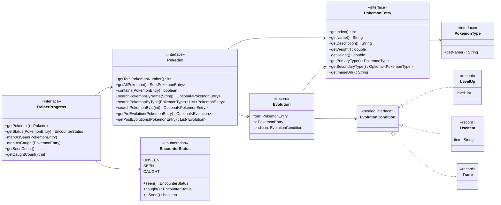
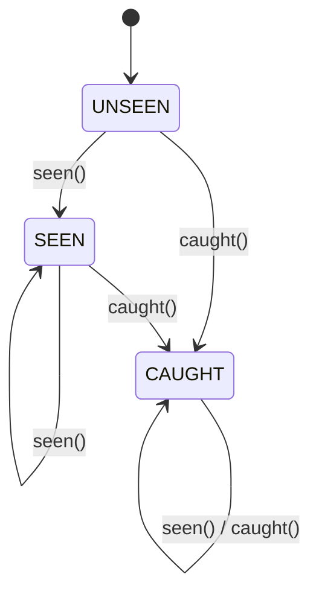

# Design

Il design traduce l'[analisi](analisi.md) e l'[architettura](architettura.md) in interfacce e classi Java.
Ogni scelta qui sotto è motivata da un requisito, da un vincolo o da un elemento critico dell'analisi.

## 1. Il dominio



Le implementazioni (`PokedexImpl`, `PokemonEntryImpl`, `TrainerProgressImpl`, `PokemonTypeEnum`) stanno nel package
`core.impl`. Chi usa il dominio conosce solo le interfacce.

### 1.1 `PokemonEntry`: una specie immutabile

Una specie è un dato **fisso** (glossario), quindi `PokemonEntry` non ha metodi che la modificano e `PokemonEntryImpl`
ha solo campi `final`.

- Non contiene **lo stato di incontro**, che appartiene ai progressi dell'allenatore (elemento critico "catalogo e
  progressi").
- Non contiene **le evoluzioni**, che sono un'entità separata (elemento critico "l'evoluzione è un'entità").
- Due specie sono uguali se hanno lo stesso **numero** (`equals` e `hashCode` usano solo l'indice), coerentemente con
  "il numero identifica univocamente una specie".

**Perché non c'è un builder.** Un builder conviene quando un oggetto ha molti parametri opzionali o si costruisce un
pezzo alla volta.
Qui gli opzionali sono solo il tipo secondario e l'immagine, e l'unico codice che crea specie è il `PokedexLoader`.
Un builder (con interfaccia e implementazione) aggiungerebbe due tipi senza risolvere un problema reale.
In più, un builder che non verifica i campi obbligatori permette di costruire specie incomplete.
Nei test, la leggibilità si ottiene con un piccolo metodo di supporto (`PokemonFixtures.entry(...)`).

### 1.2 Evoluzioni: un grafo con le specie come nodi

`Evolution` è un **record**: un valore immutabile con tre componenti (`from`, `to`, `condition`) e uguaglianza
strutturale.
Le specie non conoscono le proprie evoluzioni. È il `Pokedex` a conoscere tutti gli archi, e a ricavare entrambi i
versi:

- `getPreEvolution(entry)`: l'evoluzione che porta a `entry`, se esiste (al più una, per V5);
- `getPostEvolutions(entry)`: le evoluzioni che partono da `entry`, ordinate per numero della specie di arrivo.

Così il grafo si costruisce senza riferimenti circolari (prima le specie, poi le evoluzioni) e ogni relazione è
memorizzata **una sola volta**: il verso opposto non può divergere.

### 1.3 Condizioni di evoluzione: un tipo `sealed`

Le condizioni sono un insieme **chiuso** di varianti con dati diversi (elemento critico). In Java questo si esprime con
un'interfaccia `sealed` le cui implementazioni sono record:

```java
public sealed interface EvolutionCondition {
    record LevelUp(int level) implements EvolutionCondition { ... }
    record UseItem(String item) implements EvolutionCondition { ... }
    record Trade() implements EvolutionCondition { }
}
```

Il vantaggio si vede in chi le usa. Uno `switch` sulle condizioni non ha bisogno di un ramo `default`, e se in futuro
si aggiunge una variante il compilatore segnala ogni `switch` che non la gestisce:

```java
String label = switch (condition) {
    case LevelUp(int level) -> "Lv. " + level;
    case UseItem(String item) -> item;
    case Trade() -> "Scambio";
};
```

L'alternativa classica, una gerarchia di classi aperta con un metodo astratto come `describe()`, metterebbe nel dominio
una questione di presentazione (come si scrive una condizione), contro RNF2.

### 1.4 Progressi: `TrainerProgress` e `EncounterStatus`

I progressi sono un'entità separata dal catalogo, **riferita a un Pokédex** (`getPokedex()`).
Un nuovo allenatore parte con tutte le specie `UNSEEN`. Per questo `TrainerProgressImpl` memorizza solo le specie già
incontrate (le altre sono `UNSEEN` per definizione).

Le regole sull'avanzamento dello stato (V10) sono una piccola **macchina a stati**, e stanno nell'enum stesso:



`TrainerProgressImpl` non contiene regole sulle transizioni: si limita a scrivere `status.seen()` o `status.caught()`.
Le regole stanno quindi in un solo posto, e si testano senza costruire né un Pokédex né i progressi.

### 1.5 Dove sono garantiti i vincoli

Ogni vincolo è verificato dal primo oggetto che ha **tutte le informazioni** per farlo, al momento della costruzione:
un oggetto che esiste è sempre valido.

| Vincolo | Dove | Test |
|---------|------|------|
| V1 numero e nome unici | costruttore di `PokedexImpl` | `PokedexImplTest` |
| V2 tipo secondario ≠ primario | costruttore di `PokemonEntryImpl` (lo ignora se uguale) | `PokemonEntryImplTest` |
| V3 niente auto-evoluzione | costruttore del record `Evolution` | `EvolutionTest` |
| V4 specie dell'evoluzione nel Pokédex | costruttore di `PokedexImpl` | `PokedexImplTest` |
| V5 al più una pre-evoluzione | costruttore di `PokedexImpl` | `PokedexImplTest` |
| V6 niente cicli | costruttore di `PokedexImpl` | `PokedexImplTest`, `PokedexLoaderTest` |
| V7 livello in [1, 100], strumento con nome | costruttori dei record `LevelUp` e `UseItem` | `EvolutionTest` |
| V8 livelli crescenti lungo una catena | costruttore di `PokedexImpl` | `PokedexImplTest` |
| V9 solo specie del Pokédex | ogni metodo di `TrainerProgressImpl` | `TrainerProgressImplTest` |
| V10 lo stato avanza soltanto | `EncounterStatus` | `EncounterStatusTest`, `TrainerProgressImplTest` |
| V11 progressi indipendenti | un'istanza di `TrainerProgress` per allenatore | `TrainerProgressImplTest` |

I vincoli violati producono una `IllegalArgumentException`.

Per V6, visto che ogni specie ha al più una pre-evoluzione (V5), risalendo le pre-evoluzioni a partire da una specie si
percorre un cammino: c'è un ciclo se il cammino incontra una specie già visitata.
Per V8 si confronta ogni evoluzione per livello con quella che la precede nella catena, sfruttando il *record pattern*
di `instanceof`.

### 1.6 Caricamento: `PokedexLoader`

Il file JSON elenca le specie; ciascuna indica, se c'è, la specie da cui si evolve e la condizione:

```json
{
  "id": 5,
  "name": "Charmeleon",
  "description": "...",
  "type1": "FIRE",
  "type2": null,
  "height": 1.1,
  "weight": 19.0,
  "evolvesFrom": { "pokemon": "Charmander", "level": 16 }
}
```

Al posto di `"level"` si può indicare `"item": "Thunder Stone"` oppure `"trade": true`, sempre esattamente uno dei tre.
Il loader:

1. legge il file (in UTF-8) con Gson, in record privati che rispecchiano il formato JSON;
2. crea le specie;
3. risolve i nomi in `evolvesFrom` nelle specie corrispondenti e crea le evoluzioni;
4. costruisce il `PokedexImpl`, che verifica i vincoli.

Il loader **non verifica le regole del dominio**: se ne occupa il Pokédex. Il loader si limita a trasformare un
`IllegalArgumentException` in un `IllegalStateException` che indica un file non valido (RNF4).
Il formato JSON resta così confinato nel loader, e il dominio non ne sa nulla (RNF2).

## 2. View e controller

Seguono l'[architettura](architettura.md); qui ne fissiamo i contratti.

**`DisplayedPokemon`**: un record `(PokemonEntry entry, EncounterStatus status)` che rappresenta ciò che la view deve
mostrare di un Pokémon. Con questo tipo la view resta passiva (regola 2 dell'architettura): non chiede lo stato al
model, lo riceve.

**`PokedexView`**: mostra un elenco (`showPokemons`), una scheda (`showPokemon`), un errore (`showError`), e inoltra le
azioni dell'utente al controller impostato con `setController`.
L'implementazione JavaFX è composta da due pannelli: l'elenco con la ricerca, e la scheda con i pulsanti per
registrare avvistamento e cattura.

**`PokedexController`**: espone un'operazione per ogni azione dell'utente (`detailsForPokemon`, `searchPokemon`,
`markAsSeen`, `markAsCaught`, …) più `start()`, che avvia l'interazione. Riceve nel costruttore il `Pokedex`, i progressi
(`TrainerProgress`) e la view, senza usarli: il costruttore non ha effetti collaterali (regola 4).
