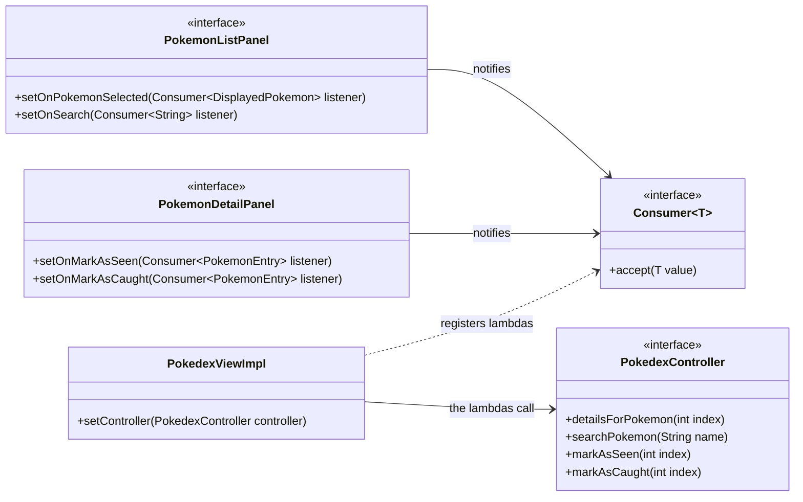

# Design dettagliato

## 1. La view

**Problema.** La view deve poter essere sostituita senza modificare il controller (architettura), e la finestra ha
due aree con comportamenti diversi: l'elenco con la ricerca e la scheda di dettaglio. Se un'unica classe le gestisse
entrambe e parlasse con il controller, diventerebbe grande e difficile da modificare.

**Soluzione.** Il controller conosce solo `PokedexView`. La sua implementazione JavaFX, `PokedexViewImpl`, è composta
da due pannelli, ciascuno dietro un'interfaccia: `PokemonListPanel` e `PokemonDetailPanel`. Entrambe estendono `Panel`,
che espone il nodo grafico da inserire nella finestra.
I pannelli **non conoscono il controller**: offrono metodi per registrare delle callback (`setOnPokemonSelected`,
`setOnSearch`, `setOnMarkAsSeen`, `setOnMarkAsCaught`). È `PokedexViewImpl`, in `setController`, a collegare ogni
callback al metodo corrispondente del controller. Ogni pannello si può quindi modificare o riusare indipendentemente
dal controller.
La view riceve tutto ciò che deve mostrare come `DisplayedPokemon` (una specie e il suo stato di incontro): decide
*come* nascondere un Pokémon non avvistato, ma non interroga il model per sapere *se* nasconderlo.

A differenza di `PokedexView`, le interfacce dei pannelli dipendono da JavaFX (`getRoot` restituisce un nodo
grafico). Non è un problema, perché sono un dettaglio interno all'implementazione JavaFX: sostituendo la view, si
sostituiscono anche loro.

**Pattern.**

**Observer**, per comunicare le azioni dell'utente dai pannelli al controller:

- gli *observable* sono i pannelli, `PokemonListPanel` e `PokemonDetailPanel`: i metodi `setOn...` registrano un
  observer per ciascun evento (selezione, ricerca, avvistamento, cattura);
- l'interfaccia dell'*observer* è `Consumer<T>` della libreria Java, e `accept` è il metodo di notifica;
- gli *observer* concreti sono le lambda che `PokedexViewImpl` crea e registra in `setController`. Ognuna chiama il
  metodo corrispondente del controller, per esempio `pokemon -> controller.markAsCaught(pokemon.getIndex())`.

Quando l'utente preme "Cattura", il pannello di dettaglio chiama `accept` sul suo observer, che a sua volta chiama
`markAsCaught` sul controller. Il pannello non sa chi lo osserva.
Ogni evento ha un solo observer: è la forma più semplice del pattern, spesso chiamata *callback*.
