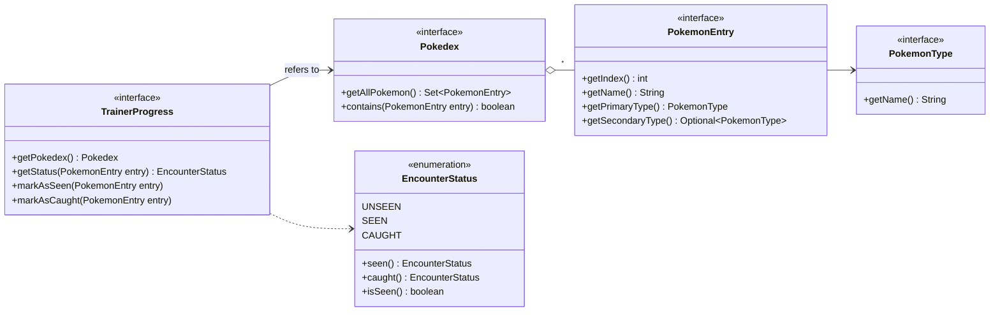
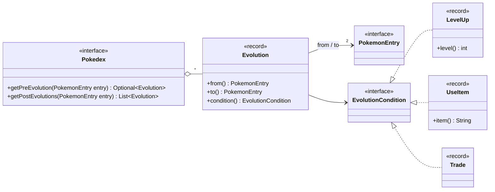
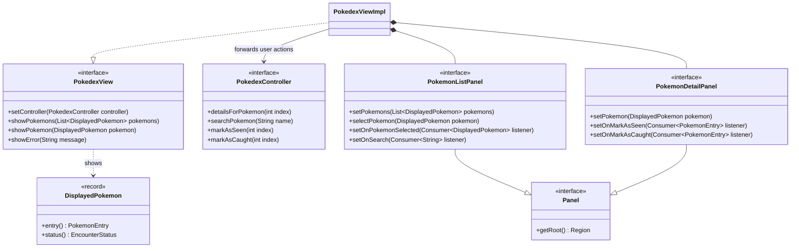
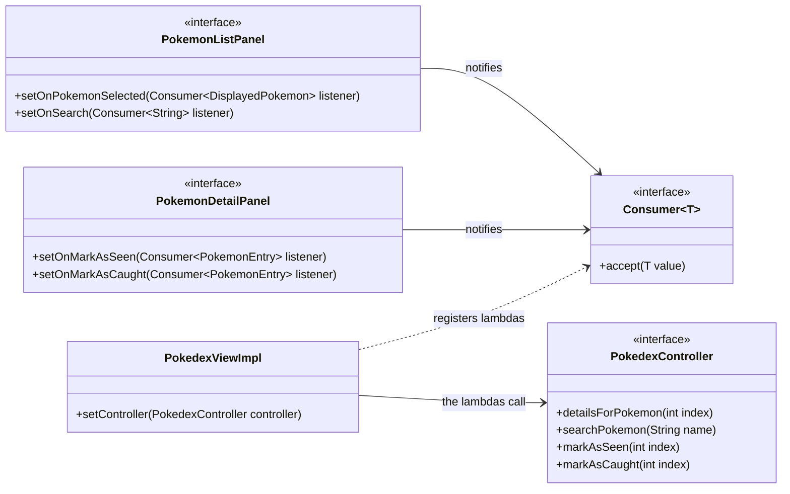

# Design dettagliato

## 1. Catalogo e progressi dell'allenatore

**Problema.** L'applicazione deve sapere quali specie l'allenatore ha avvistato o catturato (RF2–RF6). A differenza
delle specie, questa informazione cambia nel tempo, è diversa per ogni allenatore e deve rispettare le regole
V9–V11 dell'analisi.

**Soluzione.** Lo stato di incontro sta in un'entità separata, `TrainerProgress`, riferita a un `Pokedex`.
Così `PokemonEntry` e `Pokedex` restano **immutabili**: descrivono com'è fatta una specie, non a che punto è un
allenatore.
Le regole sull'avanzamento (V10) stanno nell'enum `EncounterStatus`. `seen()` e `caught()` restituiscono lo stato
successivo, e non tornano mai indietro. `TrainerProgressImpl` si limita a memorizzare lo stato delle specie incontrate
e a rifiutare quelle che non appartengono al suo Pokédex (V9). Le regole stanno così in un solo punto, e si
verificano senza costruire né un Pokédex né i progressi.

Il prezzo della separazione è un oggetto in più da creare e passare a chi lo usa: `PokedexApp` crea entrambi,
e il controller li riceve entrambi.

## 2. Evoluzioni e condizioni di evoluzione

**Problema.** Un'evoluzione collega due specie e ha dati propri: una condizione, che può essere di tre tipi con dati
diversi (un livello, uno strumento, nulla). Le evoluzioni formano catene da navigare nei due versi, e devono
rispettare vincoli che riguardano l'insieme (V5, V6, V8), non una sola evoluzione.

**Soluzione.** `Evolution` è un record immutabile `(from, to, condition)`. Le specie **non conoscono** le proprie
evoluzioni: è il `Pokedex` a contenerle tutte e a ricavare entrambi i versi, con `getPreEvolution` e
`getPostEvolutions`. Ogni relazione è quindi memorizzata una sola volta, e il grafo si costruisce in modo semplice:
prima le specie, poi le evoluzioni.
I vincoli sull'insieme sono verificati dal costruttore di `PokedexImpl`, l'unico oggetto che vede tutte le specie e
tutte le evoluzioni. Così un `Pokedex` che esiste è sempre valido. I vincoli su una singola evoluzione (V3, V7) li
verificano invece i costruttori dei record.

Le condizioni sono un'interfaccia, `EvolutionCondition`, con un'implementazione per ogni tipo: `LevelUp`, `UseItem` e
`Trade`. Ciascuna ha solo i propri dati e verifica i propri vincoli: un livello tra 1 e 100, uno strumento con un
nome (V7).

## 3. La view

**Problema.** La view deve poter essere sostituita senza modificare il controller (architettura), e la finestra ha
due aree con comportamenti diversi: l'elenco con la ricerca e la scheda di dettaglio. Se un'unica classe le gestisse
entrambe e parlasse con il controller, diventerebbe grande e difficile da modificare. In più, quando è il controller a
selezionare un Pokémon (per esempio dopo una ricerca), l'elenco non deve notificare la selezione al controller, che
altrimenti riceverebbe di nuovo la stessa richiesta.

**Soluzione.** Il controller conosce solo `PokedexView`. La sua implementazione JavaFX, `PokedexViewImpl`, è composta
da due pannelli, ciascuno dietro un'interfaccia: `PokemonListPanel` e `PokemonDetailPanel`. Entrambe estendono `Panel`,
che espone il nodo grafico da inserire nella finestra.
I pannelli **non conoscono il controller**: offrono metodi per registrare delle callback (`setOnPokemonSelected`,
`setOnSearch`, `setOnMarkAsSeen`, `setOnMarkAsCaught`). È `PokedexViewImpl`, in `setController`, a collegare ogni
callback al metodo corrispondente del controller. Ogni pannello si può quindi modificare o riusare indipendentemente
dal controller.
`selectPokemon` cambia la selezione dell'elenco senza notificare le callback, e questo interrompe il ciclo
controller → view → controller.
La view riceve tutto ciò che deve mostrare come `DisplayedPokemon` (una specie e il suo stato di incontro): decide
*come* nascondere un Pokémon non avvistato, ma non interroga il model per sapere *se* nasconderlo.

A differenza di `PokedexView`, le interfacce dei pannelli dipendono da JavaFX (`getRoot` restituisce un nodo
grafico). Non è un problema, perché sono un dettaglio interno all'implementazione JavaFX: sostituendo la view, si
sostituiscono anche loro.

**Pattern.**

**Observer**, per comunicare le azioni dell'utente dai pannelli al controller:

- gli *observable* sono i pannelli, `PokemonListPanel` e `PokemonDetailPanel`: i metodi `setOn...` registrano un
  observer per ciascun evento (selezione, ricerca, avvistamento, cattura);
- l'interfaccia dell'*observer* è `Consumer<T>` della libreria Java, e `accept` è il metodo di notifica;
- gli *observer* concreti sono le lambda che `PokedexViewImpl` crea e registra in `setController`. Ognuna chiama il
  metodo corrispondente del controller, per esempio `pokemon -> controller.markAsCaught(pokemon.getIndex())`.

Quando l'utente preme "Cattura", il pannello di dettaglio chiama `accept` sul suo observer, che a sua volta chiama
`markAsCaught` sul controller. Il pannello non sa chi lo osserva.
Ogni evento ha un solo observer: è la forma più semplice del pattern, spesso chiamata *callback*.
